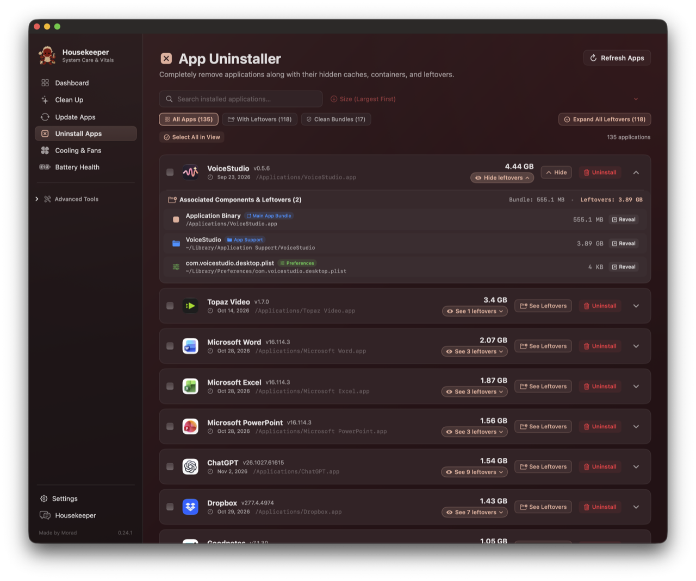
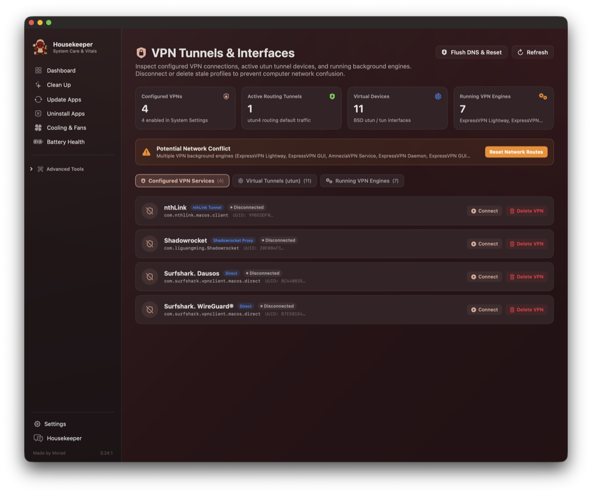

  
  <h1 align="center">Housekeeper 0.25.0</h1>
  
<strong>The All-in-One Native macOS Companion & System Maintenance Suite</strong> 
  <em>Made by Morad · Zero Subscriptions · Zero Idle Drain · Full Kitchen-Sink Bundle</em>

---

### Why I Built This

I got sick of the state of Mac maintenance tools.

On one side you have apps like CleanMyMac: bloated, subscription-hungry, wrapped in flashy animations that chew up memory, and leaving behind unkillable root daemons even after you drag the app into the trash. On the other side you have fragile, scattered terminal one-liners that you have to look up every three months when Gatekeeper declares an app “damaged,” when a rogue VPN refuses to give your default gateway back, or when your disk runs out of space because an AI package manager cached forty gigabytes of weights in a hidden directory.

Worse still, most utilities lie to you. They scan your disk, hit a folder boundary or a 20,000-file ceiling, panic, and report that forty gigabytes of applications is “12 GB” because they read the directory node instead of the bundle. Or they tell you an app has “4 leftover items” as static text and give you no way to see what those files are, where they live, or reveal them in Finder.

I wanted one app. A real kitchen-sink companion built natively in Swift that lives in your menu bar, sits at **0.0% to 0.1% CPU** when you’re not actively looking at it, speaks plainly without tech-support condescension, and actually does the work.

No monthly fees. No telemetry. No background daemons lingering after you quit. Just an honest, sharp tool for your Mac.

---

### What’s Inside Housekeeper 0.25.0

#### 1. DNS Easy Switcher (`⇧⌘D` · Sidebar ▸ Studios & Network)
A zero-privilege, native DNS manager that matches and replaces standalone tools like DNS Easy Switcher.
* **1-Click Preset Switching**: Instant switching across curated Anycast networks:
  * **Fast & Privacy**: Cloudflare (`1.1.1.1`), Google Public DNS (`8.8.8.8`), Quad9 (`9.9.9.9`), OpenDNS.
  * **Ad & Threat Blocking**: AdGuard DNS, Cloudflare Security.
  * **Sanction & 403 Bypass (Iran)**: Shecan, 403.online, Begzar — unblocking Docker, Homebrew, Gradle, Android SDK, and NPM without clunky proxy setups.
  * **Gaming & Low Latency**: Electro, Radar Game.
* **Real-Time ICMP Ping Benchmarks**: Click **[Test All Latencies]** to ping every provider simultaneously with color-coded millisecond badges (`🟢 14 ms`, `🟡 85 ms`, `🔴 Timeout`).
* **1-Click DHCP Reset & Cache Flush**: Revert back to your router's default DNS with one click, or purge macOS's resolver cache (`dscacheutil` + `mDNSResponder`) instantly.
* **Hardware Interface Targeting**: Target your active gateway (`Wi-Fi · en0`), a specific Ethernet adapter, or all network interfaces at once.

---

#### 2. App Uninstaller with Deep Leftover Inspection
Uninstalling an application shouldn’t mean leaving gigabytes of cache and state scattered in `~/Library`.

  

* **Deep Component Inspection**: Click the **[See X leftovers]** pill on any row to open the full drawer:
  * Categorized badges: `App Support`, `Caches`, `Sandbox Containers`, `Preferences`, `Saved State`, `WebKit`, and `Logs`.
  * Selectable, clean paths (`~/Library/Application Support/...`).
  * Direct **[↗ Reveal in Finder]** button for every single file or folder before you touch it.
* **Multi-Criteria Sorting**: Sort your entire software library by **Size (Largest First / Smallest First)**, **Recently Modified**, **Recently Installed**, or **Alphabetical (A–Z / Z–A)**.
* **Clean Bundles vs Leftovers**: Instant filter tabs separating self-contained apps from clutter-heavy applications.
* **Global Leftover Drawer Toggle**: Expand or collapse every leftover drawer across your Mac with one click.

---

#### 3. Space Lens: Real APFS Storage Intelligence
Most storage visualizers on macOS either hang or guess. Space Lens uses direct kernel-level parallel traversal to measure the real size of your files:
* **Accurate Bundle Traversal**: Measures the true recursive size of `/Applications` (e.g. 92.2 GB), `Documents` (218 GB), and `~/.Trash`. Zero artificial fallback floors.
* **Fast Spotlight Indexing**: Identifies big and old files (>200 MB) across your drive in under 50 milliseconds using native metadata queries.
* **Clickable Category Cards**: Jump directly from a category breakdown into the folder browser with live progressive calculation indicators.

---

#### 4. VPN Tunnels & Virtual Interfaces Watchdog (`⇧⌘V`)
When you disconnect a VPN and your internet silently breaks, it’s usually because a virtual tunnel or routing table entry got stuck.

  

* **Kernel `utun` Devices**: Inspects active BSD tunnel interfaces, MTU values, and IP assignments.
* **Routing Table Conflicts**: Highlights whether a tunnel has hijacked your default gateway (`0.0.0.0/0`).
* **Background VPN Daemons**: Surfaces background processes holding network extensions with PID, CPU %, and memory footprint.
* **1-Click Rescue**: Disconnect stuck tunnels, permanently delete orphaned VPN network services, and flush routing tables and DNS cache with one click.

---

#### 5. App Doctor: Gatekeeper & Damaged App Repair
macOS Sequoia loves to claim that an app downloaded from GitHub or the web is “damaged and can’t be opened.” App Doctor eliminates the terminal dance:
* **Quarantine & Provenance Stripping**: Clears `com.apple.quarantine` and purges download tracking tags (`xattr -cr`).
* **Permissions & Code Signing**: Ensures execution bits on `Contents/MacOS` binaries and applies an ad-hoc code signature (`codesign --force --deep --sign -`).
* **Drag-and-Drop or Shelf**: Drag any broken app into the repair card, or pick from the automatically detected Quarantined Apps shelf.

---

#### 6. Battery Health & Power Management
Reads Darwin IOKit `AppleSmartBattery` hardware registers directly without running heavy profiling scripts:
* **Hardware Telemetry**: Real-time cycle count, factory design capacity vs maximum charge capacity, cell wear loss in mAh, voltage, amperage, and battery controller IC.
* **Power Delivery & States**: Detects USB-PD adapter wattage, Optimized Battery Charging (80% hold state), and AC pass-through.
* **Sleep Inhibitor Watchdog**: Live `pmset -g assertions` parser showing which applications are preventing your Mac from entering deep sleep, with one-click quit buttons.

---

#### 7. Full Kitchen-Sink Bundle: MediaDock 9 & Bookbind
Housekeeper is a full suite. You do not need separate standalone installations of MediaDock or Bookbind:
* **MediaDock 9**: Native YouTube, Spotify, and Apple Music downloader supporting video up to 4K and lossless audio extraction (FLAC, MP3, M4A, OPUS). Displays exact CLI commands for full transparency.
* **Bookbind (`⇧⌘B`)**: Built-in audiobook studio. Drag in loose chapter tracks, look up official cover art and metadata from the iTunes catalog, and bind them into a finished, beautifully chaptered `.m4b` audiobook. Runs locally on port `8765` with pre-packaged `ffmpeg` and `ffprobe` binaries inside the bundle.

---

#### 8. Native macOS Visual Ergonomics

  

* **Monochrome Menu Bar Silhouette**: Replaced colored raster icons in the menu bar with a native vector cut-paper template silhouette (`image.isTemplate = true`). It adapts dynamically to dark and light menu bars and high-contrast clicks, matching native macOS buttons like Wi-Fi and Bluetooth.
* **Transparent Maid Octopus Mascot**: Morad’s hand-crafted brand mascot floats on a clean transparent background across the Dock, Finder, and in-app dashboard—with zero artificial white boxes or clipped borders.
* **Zero Idle Drain**: Engineered with strict motion budgets and `LazyVStack` rendering. When idle in the menu bar, Housekeeper sits at **0.1% CPU**.

---

### Checksums & Downloads

| Package | Architecture | SHA-256 Checksum |
| :--- | :--- | :--- |
| **`Housekeeping-macOS-universal.zip`** | Universal (`arm64` + `x86_64`) | `3199eee15f77e51b0aeeb03d035ab40ab66d067ce0d14e854ea6cc40f9abc61a` |
| **`Housekeeping-macOS-arm64.zip`** | Apple Silicon (`M1/M2/M3/M4`) | `6edcd284bc684ce33f854a8eeefe7a269cc098cd08d321fba4d1258830ef8a83` |
| **`Housekeeping-macOS-x86_64.zip`** | Intel Macs | `a7916dbf51994fc74850c6dc1bcf15956574e6140c92f8cb705a18646b74ae86` |

*Built for macOS 13.0 (Ventura) and later.*
