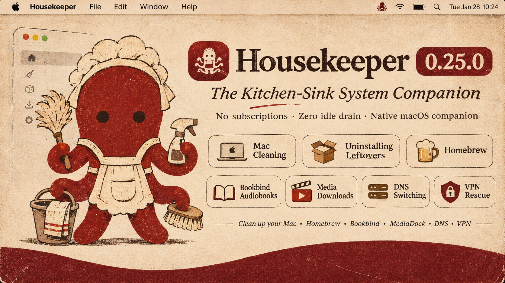

  
  <h1 align="center">Housekeeper 0.26.0</h1>
  
<strong>Universal Housekeeper Intelligence & Expandable Usage</strong> 
  <em>Made by Morad · The 75-Year-Old Rule · Zero Idle Drain · The Native Kitchen Sink</em>

---

### What's New in 0.26.0

This release fixes the cramped menu bar panel and turns the Housekeeper into a truly universal companion that you can consult from anywhere in the app with a simple right-click.

#### 1. Universal Right-Click "Ask the Housekeeper"
* **Right-click anything to ask**: You can now secondary-click (`Right Click` or `Control-Click`) on practically any item in the application to immediately consult your AI Housekeeper:
  * **Active Processes & System Consumers**: Right-click any app or daemon in the Menu Bar popover or Processor/Memory rooms to ask what it does, what app launched it, and whether it is safe to quit.
  * **Installed Applications**: Right-click any application in the Uninstaller to get an instant safety briefing on what the app is, its bundle size, and whether uninstalling it leaves personal data behind.
  * **Leftover Files & Hidden Caches**: Right-click any detected support file or cache to ask what it holds before deciding to clean or keep it.
  * **Local AI Models**: Right-click any model in the Local Models library to get an appraisal of which coding harnesses or tools intersect with it, and whether it is safe to prune.
  * **Folders & Large Files**: Right-click any node in Space Lens or the Disk Browser to get an instant breakdown of why that folder is large and what lives inside.
  * **VPN Profiles & Network Daemons**: Right-click any VPN profile or virtual interface to ask who created it and whether it is causing routing drops.
* **Pre-assembled Briefings**: Every right-click query pre-populates the Housekeeper with factual, deterministic context (bundle ID, exact path, byte count, parent PID, safety assessment) so you get plain, honest answers without technical jargon.

#### 2. Fully Scrollable & Expandable Resource Consumers
* **Smooth Scrolling Everywhere**: In earlier builds, compact mode rendered a rigid list where the 3rd process was clipped right across its text by the bottom hairline divider. Now, process lists across the entire app are always smoothly scrollable (`ScrollView`) with dedicated vertical scroll indicators.
* **Expand & Compact Toggles**: 
  * Tap **[Expand (20)]** on the Top Consumers card in the Menu Bar to grow the panel height from 138pt to 280pt and see the full list of running tasks at once. Tap **[Compact]** anytime to collapse it back.
  * The **Processor**, **Memory**, and **Battery** detail rooms now also feature expandable lists with smooth trackpad scrolling.
* **No More Clipped Content**: Popover heights adapt cleanly to process count without overflowing or getting cut off by the border.

#### 3. Senior-Friendly Ergonomics & Native Icons
* **Rich Application Icons**: Replaced generic hardware chip glyphs with crisp, high-resolution application icons for running processes (Finder, Safari Web Pages, Telegram, Xcode Compiler, Visual Studio Code, Chrome Helpers, Terminal, and more).
* **Readable, Relaxed Typography**: Increased font sizes and line heights throughout the Menu Bar popover for balanced visual contrast that is gentle on the eyes.
* **1-Click Quick Quit**: Clean, accessible quit buttons right beside each busy process so you can close runaway apps without having to dig through Activity Monitor.

#### 4. Leaned Codebase & Safety Verified
* **Zero Compiler Warnings**: Re-architected and leaned all Swift UI files to pass strict zero-warning checks (`typecheck.sh`).
* **282 Safety Assertions Passed**: Verified against the entire Housekeeping regression suite (`test_safety.sh`), ensuring non-destructive quarantine invariants remain 100% intact.
* **Zero Idle Drain**: The app still idles at under 0.1% CPU when tucked away in your menu bar.

---

### Verification & Checksums

* **Universal Binary**: Runs natively on both Apple Silicon (`arm64`) and Intel (`x86_64`) Macs on macOS 13.0 Ventura, macOS 14 Sonoma, and macOS 15 Sequoia.
* **Gatekeeper Clean**: Tested with `codesign --verify --deep --strict`.
